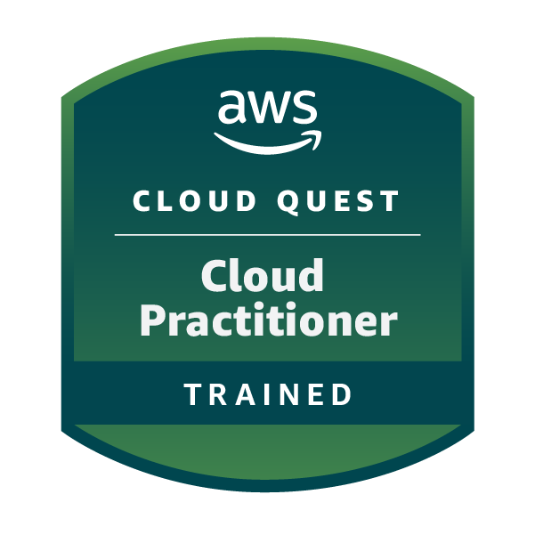
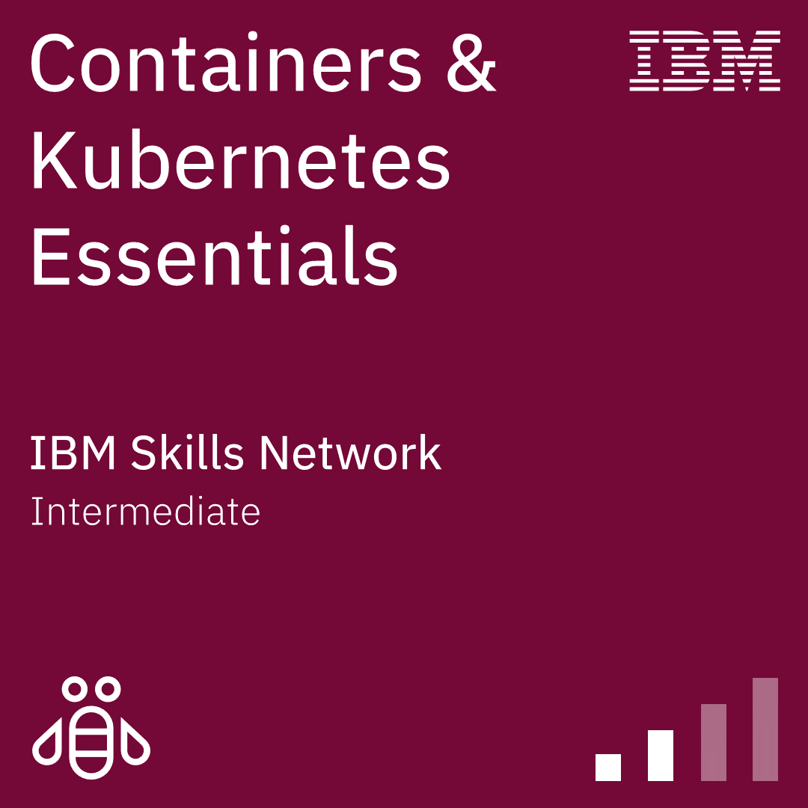
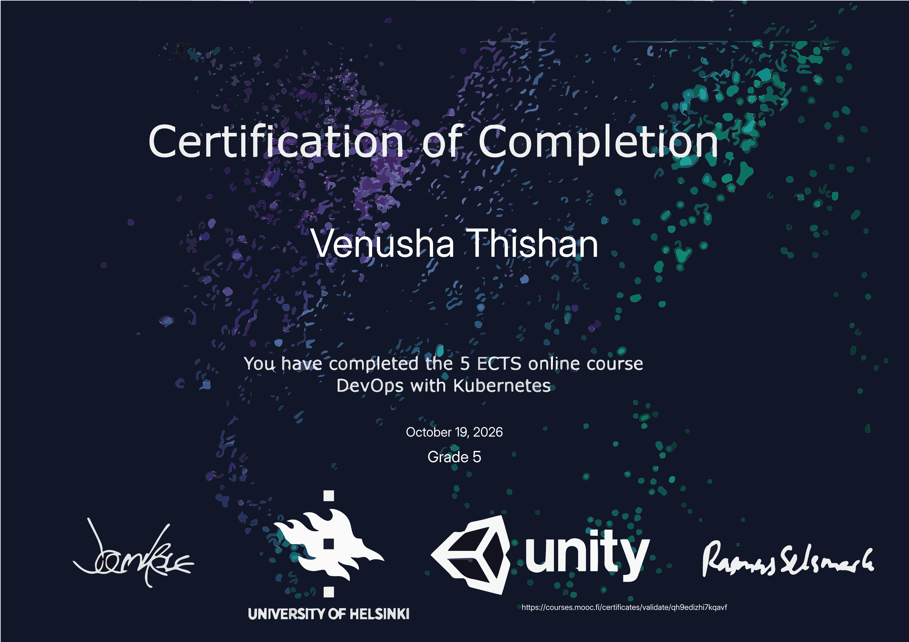
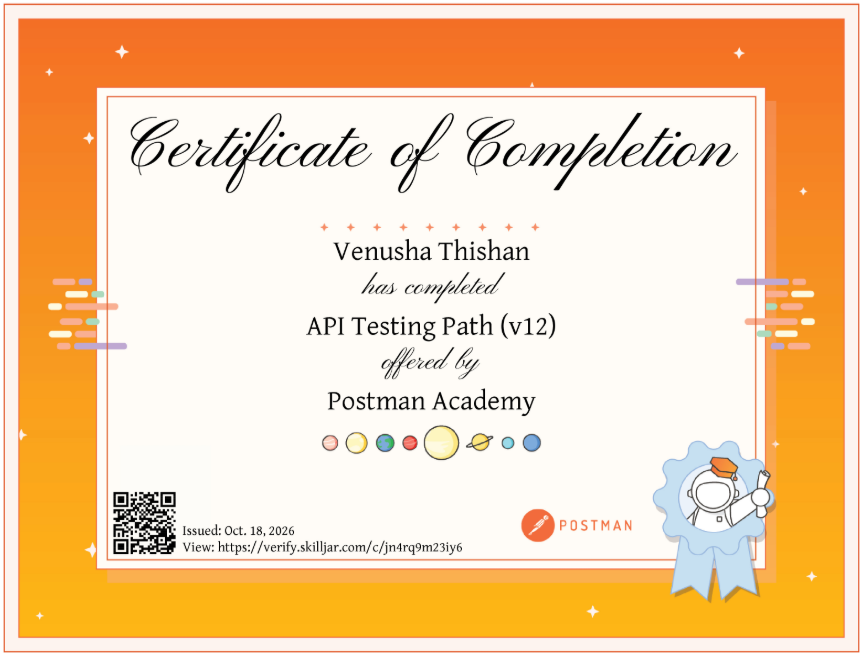
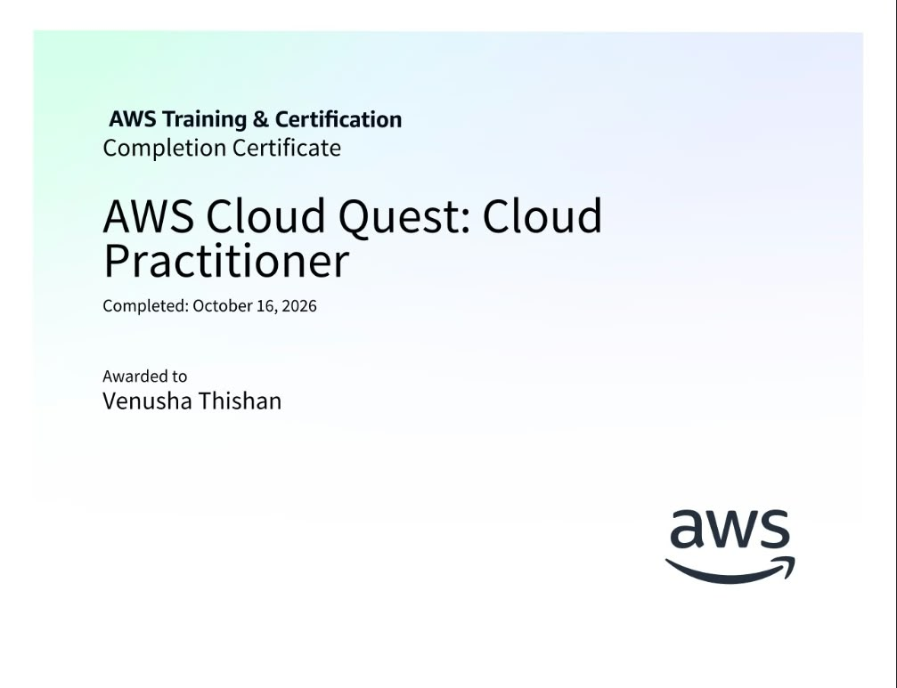
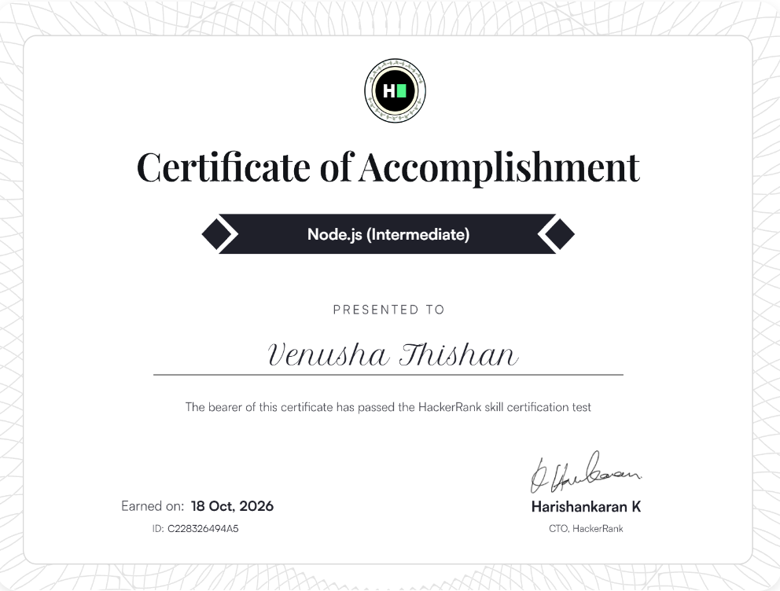
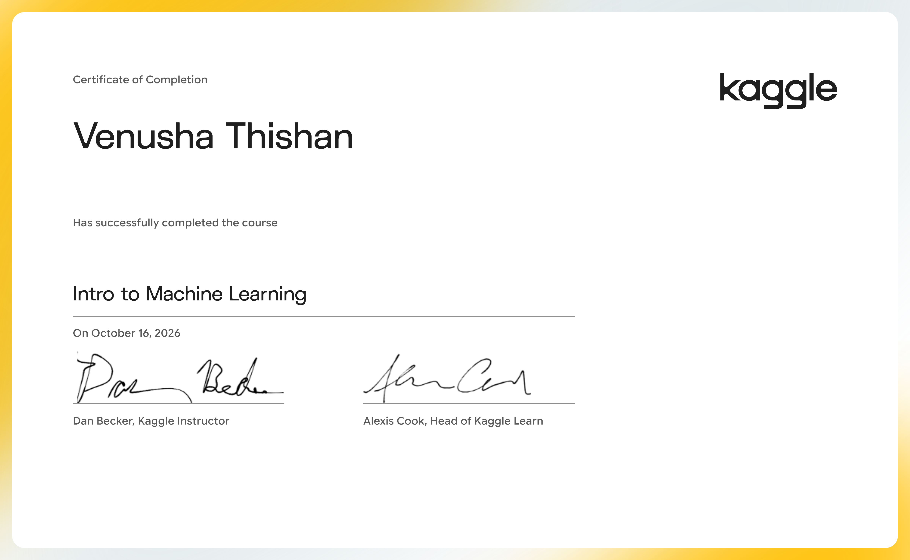
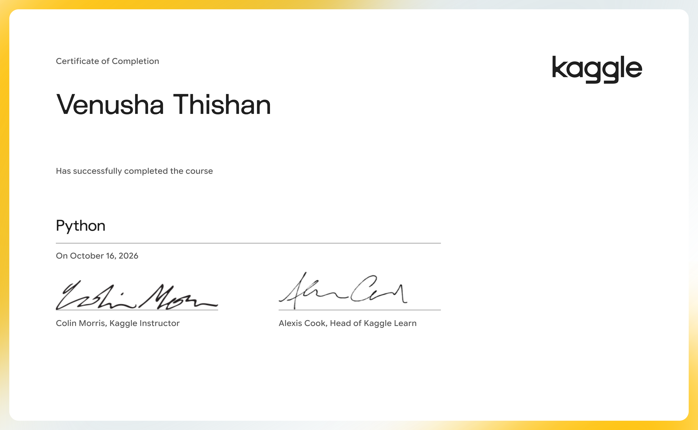
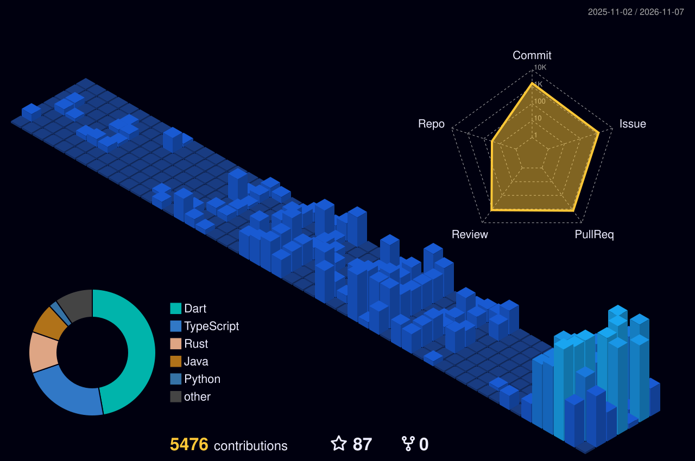

  

<h1 align="center">Hi 👋, I'm Venusha Thishan</h1>

<h3 align="center">
  
</h3>

  

---

## 🧠 About Me

💡 Passionate developer focused on **Full Stack Development & IoT Systems** · **Backend Developer · AI/ML Enthusiast · DevOps** 
🌐 Portfolio: [www.vthish.dev](https://www.vthish.dev) 
🔧 Currently building **smart solutions (like automated systems & real-world apps)** 
🎯 Goal: Become a **top-tier software engineer + innovator** 
📍 Based in Sri Lanka 🇱🇰

---

## 🚀 Featured Projects

  
  

  <a href="https://github.com/vthish?tab=repositories">
    🔎 View All Projects
  </a>

---

## 🧊 Tech Stack

### 💻 Programming

### 🌐 Web & Mobile

### ⚙️ Tools & Platforms

---

## 🏆 Certifications & Badges

  
  &nbsp;&nbsp;&nbsp;&nbsp;
  

<table align="center" width="100%">
  <tr>
    <td align="center" width="33%">
      <a href="https://courses.mooc.fi/certificates/validate/qh9edizhi7kqavf" target="_blank">
         
        <b>University of Helsinki</b> DevOps with Kubernetes (5 ECTS)
      </a>
    </td>
    <td align="center" width="33%">
      <a href="https://verify.skilljar.com/c/jn4rq9m23iy6" target="_blank">
         
        <b>Postman Academy</b> API Testing Path (v12)
      </a>
    </td>
    <td align="center" width="33%">
      <a href="https://raw.githubusercontent.com/vthish/vthish/main/CertifatesAndBadges/AWS.jpeg" target="_blank">
         
        <b>Amazon Web Services (AWS)</b> Cloud Quest: Cloud Practitioner
      </a>
    </td>
  </tr>
  <tr>
    <td align="center" width="33%">
      <a href="https://www.hackerrank.com/certificates/c228326494a5" target="_blank">
         
        <b>HackerRank</b> Node.js (Intermediate & Basic)
      </a>
    </td>
    <td align="center" width="33%">
      <a href="https://raw.githubusercontent.com/vthish/vthish/main/CertifatesAndBadges/Venusha%20Thishan%20-%20Intro%20to%20Machine%20Learning.png" target="_blank">
         
        <b>Kaggle</b> Intro to Machine Learning
      </a>
    </td>
    <td align="center" width="33%">
      <a href="https://raw.githubusercontent.com/vthish/vthish/main/CertifatesAndBadges/Venusha%20Thishan%20-%20Python.png" target="_blank">
         
        <b>Kaggle</b> Python Course
      </a>
    </td>
  </tr>
</table>

  
  

  

---

## 📊 GitHub Stats

  
  

---

## 🔥 Contribution Streak

  

---

## ⚡ Activity Graph

  

---

## 🌌 3D Contribution Graph

  

---

## 📬 Contact Me

---

  ⚡ Designed like a portfolio | Built with passion 💻🔥

